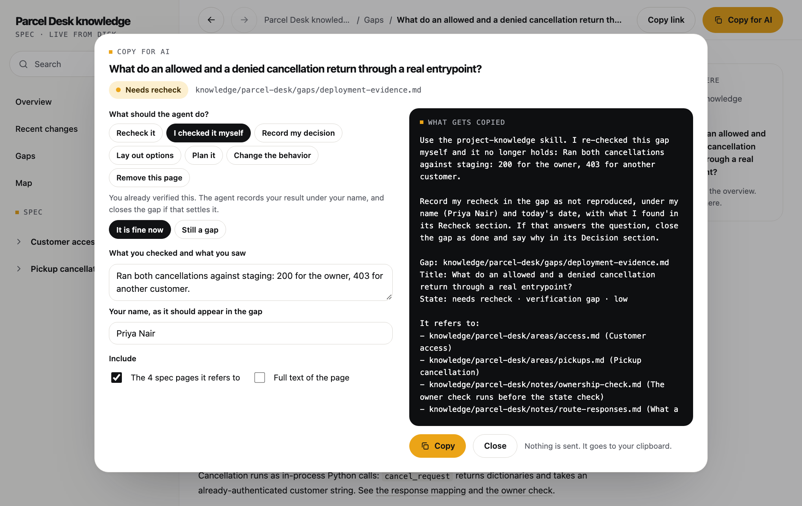
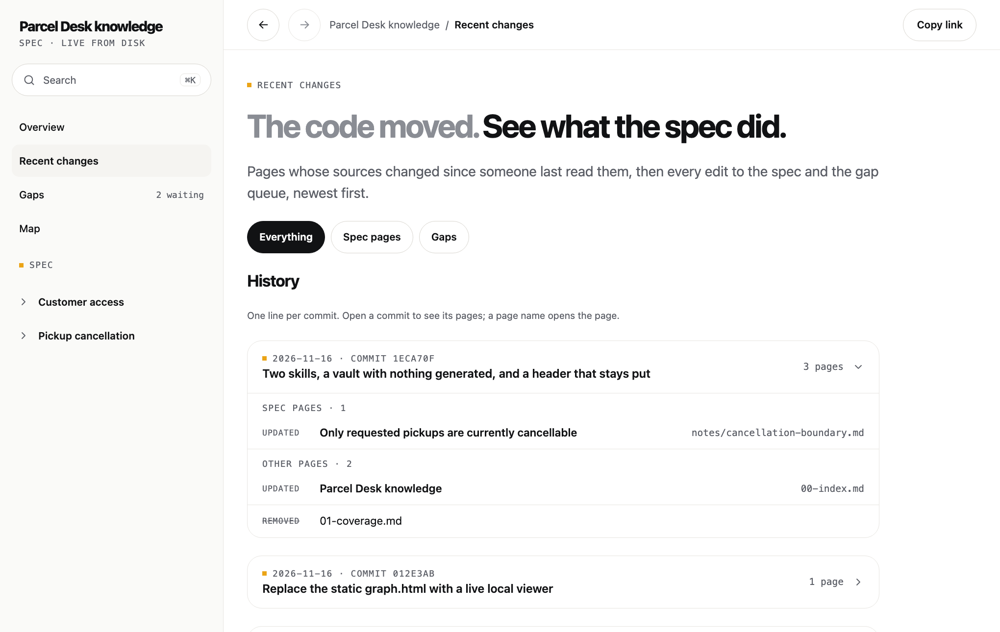

# Project Spec Skills

**Turn a repository into a spec people can read: one page per feature, every business rule numbered.**

Agent skills for the moment after you built fast with AI and now need to know what the product really does. The agent reads the code you already have and writes down how it works. You read the result in a local viewer, question it, and change the product starting from it.

This is an early project. It has been used on a few real repositories; [VALIDATION.md](VALIDATION.md) says what was checked and what was not.


## Setup

You need an agent that can read your repository (Claude Code or Codex), Python 3.10+, Git, and Node 18+ for the `npx` commands.

**1. Install the skill** (once per machine):

```sh
npx project-spec install --claude      # or --codex
```

**2. Open your agent in the project and paste this:**

```text
Use the project-knowledge skill to build a knowledge vault for this repository.

First take the inventory: every app and package, and every way into each one:
what a person can open, what another system can call, what runs on its own and
what the product sends out. Write it to the inventory file before any page.

Then go one feature at a time and finish each before the next. Describe only
what the code does: one page per feature with numbered business rules, and
every doubt as its own gap.

If you run out of time, stop at the end of a feature and tell me how many
features are finished, in progress and not started.
```

**3. Read what it wrote:**

```sh
npx project-spec serve
```

A big repository takes more than one session. To go on where the last one stopped:

```text
Use the project-knowledge skill and continue the map from the inventory file.
```

The agent writes only Markdown under `knowledge/<project>/`. It does not change application code, commit or push. There is also a Claude Code plugin, a manual install and a way to pin one version for a team: see [Install and update](docs/install.md).

### What to ask next

| When | Prompt |
| --- | --- |
| A page looks thin | `Use project-knowledge to explore <feature> until it is finished.` |
| You want the gaps checked | `Use project-knowledge in gaps mode: recheck the high-priority gaps against the code.` |
| You changed the code | `Use project-knowledge to record this change in the spec.` |
| Others changed the code | `Use project-knowledge to record what changed last week.` or, for everything since the last review, `... to sync the vault.` |
| A gap is accepted | `Use project-knowledge to plan the gap <name>. Plan only.` |
| You have one question | `Use project-knowledge to investigate: <question>.` |
| A document says how it should work | `Use project-knowledge to audit <document> against the code.` |

More in [Working with the skills](docs/workflows.md#example-prompts).

## What you get

A folder of plain Markdown in your repository (it also opens in Obsidian) with two layers that stay apart:

- **The as-built spec.** How the code works now, taken only from the source. Each feature has one page: what it is for, how it works, its fields and its numbered rules. What people agreed in chats is not part of it.
- **The gap queue.** The agent's questions about what is missing, doubtful or worth adding, one per page. People re-check each one and decide it. The agent never records a decision nobody made.

A page looks like this:

```markdown
# Only requested pickups are currently cancellable

A customer who no longer needs a pickup cancels it, and the service lets that
happen only before anyone has started work on it.

## Business rules

| ID | Rule |
| --- | --- |
| BR-CANCEL-01 | A pickup can be cancelled only while its state is `requested`. |
| BR-CANCEL-02 | In any other state the cancellation is refused with "Only requested pickups can be cancelled" and nothing is changed. |
```

A rule keeps its number for good, so a reviewer, a tester or a support person can say "BR-CANCEL-02 is wrong" instead of describing a screen. When a file a page relies on changes, the page is marked for re-reading.

## The viewer

One local page, read from the files on disk. Nothing is built or uploaded. It comes with the npm package and is not copied into your project; the vault also opens in Obsidian, so the viewer is optional.

1. **Read** a feature page: its purpose, its flow, its rules.
2. **Find** anything with search, including a rule number.
3. **Ask**: "Copy for AI" turns the page and your own words into a request for your agent.
4. **See what moved**: the pages whose code changed since they were last checked.

| Search | Copy for AI |
| --- | --- |
|  |  |
| **Recent changes** | **Gap queue** |
|  |  |

[The viewer](docs/viewer.md) describes every screen, and how to show the spec on a development server for the rest of the team.

## The skill

[project-knowledge](skills/project-knowledge/SKILL.md) writes and maintains the spec and the gap queue. It also audits written requirements against the code, answers one question, re-checks one gap, plans a gap you accepted and follows Git history. It never changes application code.

## Keep it current

A spec is only worth reading while it is true. The cheap way to keep it true is to let whoever changes the code correct the spec in the same task, as an edit the size of the change: a changed validation message is one row of one table, not a new review of the project.

```sh
npx project-spec instructions --file AGENTS.md      # or CLAUDE.md, GEMINI.md, .cursor/rules/project-spec.mdc
```

This writes a short block into the file your agent reads at the start of a session (Codex, Cursor, Claude Code, Gemini CLI, GitHub Copilot). It asks the agent to read a feature's page before changing it and to correct the changed rules afterwards. Run it again after an update and it replaces the block and leaves the rest of the file alone.

## Upgrading

```sh
npx project-spec@latest update      # refresh every installed copy of the skill
npx project-spec@latest check       # an older spec still passes; this lists anything to fix
```

Your spec needs no conversion: every release since 0.7.0 only added optional things to it. Two releases changed what is installed. 0.11.0 removed the `spec-change` skill; `update` deletes its copies and keeps a backup, and a request that named it now names `project-knowledge`. 0.10.0 stopped copying the viewer into your project; open it with `npx project-spec serve`. [Upgrading from an earlier version](docs/install.md#upgrading-from-an-earlier-version) has the steps for each release.

## Commands

```sh
npx project-spec serve                 # read the spec in the browser
npx project-spec coverage              # what the code has that no page mentions yet
npx project-spec build --out FILE      # the viewer as one file, to show on a server
npx project-spec instructions          # the block that asks agents to keep the spec current
npx project-spec status                # where the skill is installed and whether it is current
npx project-spec update                # refresh the installed copies
```

## Read more

| Page | What is in it |
| --- | --- |
| [Install and update](docs/install.md) | npm, the Claude Code plugin, Codex, a manual copy, keeping copies current. |
| [The viewer](docs/viewer.md) | Every screen, a short command to open it, and the spec on a server. |
| [What the spec contains](docs/spec.md) | The sections of a feature page, big features and several apps, how deep the first map goes, the coverage report, the files in the vault. |
| [Working with the skills](docs/workflows.md) | Example prompts, the example project, keeping the spec current, deciding gaps, two people updating the vault. |
| [Parcel Desk](examples/parcel-desk/README.md) | A small fictional project with a ready-made vault to try the viewer on. |
| [VALIDATION.md](VALIDATION.md) | What was actually checked for each release, and the limits. |
| [CONTRIBUTING.md](CONTRIBUTING.md) | Checks, skill boundaries and how releases are made. |

## What it does not do

- The agent writes the claims. The helpers check structure and track which files changed; a helper alone does not understand your code.
- The spec says what the code does. It does not prove that the deployed application works.
- Nothing runs by itself: no schedule, no hooks, no commits or pushes. You share the Markdown through your normal Git workflow.
- No MCP server, cloud service, paid API or Obsidian plugin is needed.

The skills and examples are original work under the [MIT license](LICENSE). This is an independent project; Obsidian and the agent hosts are not its sponsors.
