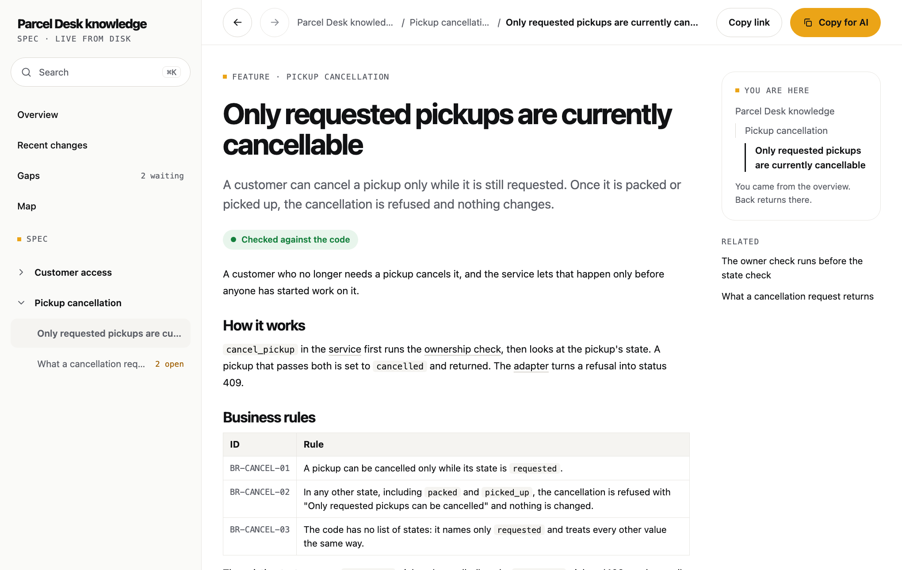
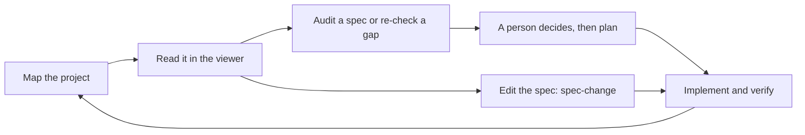
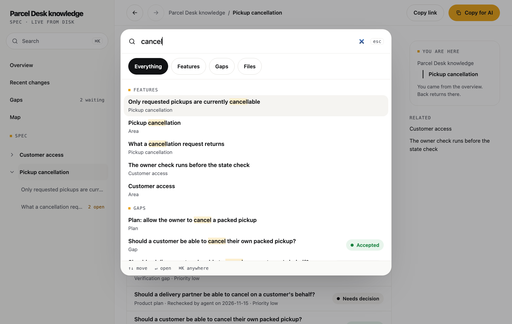
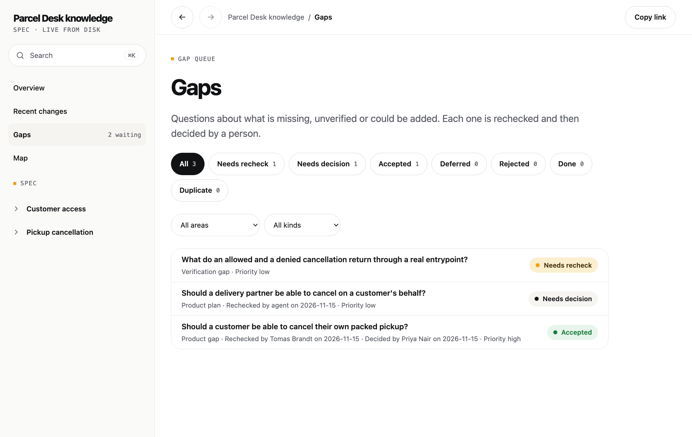
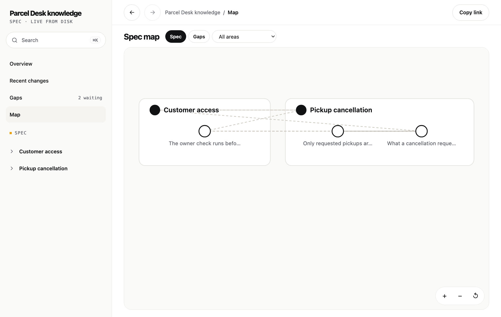

# Project Spec Skills

**Turn a repository into knowledge you can navigate, question, and maintain.**

Two agent skills: one to understand existing software and keep that understanding true, one to change it starting from the spec. Start with the code you already have. Keep explanations in English Markdown with links to the evidence.

The knowledge skill produces an **Obsidian-compatible vault** with two clearly separated layers:

- an **as-built spec**: exactly how the code is implemented now, derived only from source. Each feature has one page: what it is for, how it works, its fields and its business rules, every rule with a number you can quote. What people or agents agreed in chats is not part of it.
- a **gap queue**: the agent's guesses about what is missing, doubtful or worth adding, one question per page. People re-check each gap and decide it, with a separate discussion and decision for every item.

To read it there is a small **local viewer**: one command opens the spec as a plain document in your browser, straight from the files on disk, and turns what you read into a request for your agent. [See how it works](#read-the-spec-then-work-from-it). Obsidian works too and is optional. The other skills work with ordinary repository files, with or without a vault.



## Pick a skill

| For | Skill | What you get |
| --- | --- | --- |
| Understand | [project-knowledge](skills/project-knowledge/SKILL.md) | An as-built spec of capabilities and behavior and a separate queue of individually tracked gaps. It also audits written requirements against the code, answers one question or re-checks one gap, keeps the spec in step with Git history and reconciles concurrent vault updates. It never changes application code. |
| Change (experimental) | [spec-change](skills/spec-change/SKILL.md) | A source-grounded plan with decision gates and observable acceptance criteria, or the change itself: you edit the spec on a branch, the agent reviews the diff and asks its questions before any code, then implements it and checks each changed statement against the code. |

Each skill is independently usable. A useful sequence is:



`project-knowledge` never changes application code; `spec-change` is the one that does, and only after it has asked its questions. Reading a test establishes what it expects; only running it produces a test result.

## Read the spec, then work from it

The vault is plain Markdown: easy for an agent to write, tiring for a person to read file by file. The viewer is the reading side. It is one local page that reads the vault from disk every time it loads, so there is nothing to build first.

It is made for one loop:

1. **Read.** A tree lists the areas and the features in each. A feature page says in plain words what the feature is for and how it works, then lists its fields and its numbered business rules; the source files and the properties are folded away. A breadcrumb, Back and Forward and a "You are here" card say where you are, and the related pages are listed beside the text.
2. **Find.** Search (Cmd/Ctrl+K) covers pages, gaps and the text of the files the pages cite. A rule number such as `BR-CANCEL-02` finds its page.
3. **Ask.** "Copy for AI" on any page turns the page and your own words into a request for your agent that names the page file. For a gap: recheck it, record a check you did yourself, record your decision, lay out the options, plan it. For any page: change the behavior, ask a question, or remove a page that is only noise. Each choice says what will happen, and you see the exact text before you copy it.
4. **Let the agent work.** Paste the brief into your agent. With `spec-change` it asks its questions first, edits the spec on a branch, builds the change and checks every changed statement against the code.
5. **See what moved.** Recent changes lists the pages whose cited sources changed since the last review, the pages not committed yet, and the vault's Git history with what each summary said before and after.

| Search | Copy for AI |
| --- | --- |
|  |  |
| **Recent changes** | **Gap queue** |
|  |  |



The screenshots show the fictional [Parcel Desk](examples/parcel-desk/README.md) example. The viewer only reads: it listens on `127.0.0.1`, makes no network requests and writes nothing to the repository. "Copy for AI" puts text on your clipboard; the only thing it keeps in your browser is the name you sign a check or a decision with. A link to a file in the repository opens inside the viewer, Markdown rendered and code with the cited lines marked.

### Open it with one command

With the [package](#as-a-package) in your project, add a script to `package.json`:

```json
{
  "scripts": {
    "spec": "project-spec serve"
  }
}
```

`npm run spec` then opens the viewer for that project. Without the package, the command is the helper itself, where `<skill>` is the `project-knowledge` folder (`~/.claude/skills/project-knowledge`, `~/.codex/skills/project-knowledge`, or a copy kept inside the repository):

```sh
python3 <skill>/scripts/knowledge.py serve --repo . --open
```

Give that a short name once, as a `Makefile` target (the second line starts with a tab) or a shell alias:

```make
spec:
	python3 <skill>/scripts/knowledge.py serve --repo . --open
```

```sh
alias spec='python3 ~/.claude/skills/project-knowledge/scripts/knowledge.py serve --open --repo'
```

The vault is found by itself when the repository has one under `knowledge/`; otherwise add `--vault PATH`. The page is served on port 8757, or another free port when that one is taken; `--port N` picks one. `project-spec serve` opens the browser unless you add `--no-open`; the helper opens it only with `--open`. If the vault has errors, the page lists them.

## What a feature page says

Every feature, screen or flow has one page, and all of them have the same sections in the same order. A section the feature does not have is left out.

| Section | What it holds |
| --- | --- |
| Opening | What the feature is for, who uses it and where it is found. |
| `How it works` | What happens, step by step, in the product's words. |
| `Fields` | One row per input: whether it is required, its rule, the message when it is refused. |
| `Business rules` | One numbered row per rule, with the values from the code. |

This is the page in the screenshot above, as the agent wrote it:

```markdown
# Only requested pickups are currently cancellable

A customer who no longer needs a pickup cancels it, and the service lets that
happen only before anyone has started work on it.

## How it works

`cancel_pickup` in the service first runs the ownership check, then looks at the
pickup's state. A pickup that passes both is set to `cancelled` and returned.

## Business rules

| ID | Rule |
| --- | --- |
| BR-CANCEL-01 | A pickup can be cancelled only while its state is `requested`. |
| BR-CANCEL-02 | In any other state the cancellation is refused with "Only requested pickups can be cancelled" and nothing is changed. |
```

A rule's number is its name. It stays the same when the rule's text changes, a new rule gets the next free number, and a removed rule's number is never used again, so a number quoted in a ticket, a test or a chat keeps pointing at one rule. `check` fails when a number appears twice in the vault.

Things the code registers in one place and no single feature owns (background jobs, emails, routes, roles, plan limits) are listed in reference pages: one table with every item. A page cites the one to five files that decide its behavior. When one of them changes, the page is marked "Code changed since the last check" until someone re-reads it.

## Why use this?

- **Onboarding:** follow a workflow across UI, API, policy, persistence and tests without rediscovering the same paths every session.
- **Change planning:** see which rules and related areas a change can affect before writing code.
- **Rules you can point at:** a reviewer, a tester or a support person can say "BR-CANCEL-02 is wrong" instead of describing a screen.
- **Useful gap reports:** each doubt is its own page, typed as a missing capability, outdated documentation, an unverified scenario, a conflict or an undecided product proposal, and carries who re-checked it and who decided it.
- **Team memory:** commit the notes with the project. A manual sync reviews changes from all contributors since the last reviewed commit, including older commits and merges.

The graph records relationships between explanations. It does not infer a complete runtime dependency graph or prove that the deployed application works. The agent never records a decision nobody made: accepting, rejecting or deferring a gap is a person's act.

## Install and run

These are [Agent Skills](https://agentskills.io/specification): each folder has a `SKILL.md` entry point. They require an agent that can read your repository. The knowledge helpers need **Python 3.10+** and **Git**; they have no package dependencies. No MCP server, cloud service, paid API or Obsidian plugin is required by the bundle.

### As a package

The repository is also an npm package with one command, `project-spec`. It needs Node 18+ in addition to Python. It is installed from GitHub; it is not on the npm registry.

```sh
npm install --save-dev github:WorldStoryCm/project-spec-skills
npx project-spec install --claude      # or --codex, or --dir knowledge/tooling
npx project-spec serve                 # the viewer for this project
```

The lockfile pins the version for everyone on the project, and `npm update project-spec-skills` moves it forward. The command then keeps every copy of the skills in step with that version:

```sh
npx project-spec status    # where the copies are and whether each is current
npx project-spec update    # refresh every copy that status lists
```

`status` and `update` look in `~/.claude/skills`, `~/.codex/skills` and the usual folders of the current project (`knowledge/tooling`, `.claude/skills`, `.codex/skills`, `.agents/skills`). `update` refreshes what is there and adds nothing new; `install` adds. A copy you edited by hand is not replaced unless you pass `--force`, and the old files are kept under `~/.project-spec/backups` first. `--skills project-knowledge` limits an install to the skills you name.

Outside any project, `npx github:WorldStoryCm/project-spec-skills status` runs the same command without installing it.

### Codex

Ask the built-in skill installer:

```text
Install these skills from WorldStoryCm/project-spec-skills:
skills/project-knowledge
skills/spec-change
```

If you already have a skill with the same name, compare versions before replacing it. The installer in Codex handles its own destination. In Codex you can name a skill with `$name`, for example `$spec-change`.

### Claude Code

Copy the whole skill folder (it contains the references and helper scripts) to one of:

- `~/.claude/skills/<name>/` to use it in all your projects, or
- `.claude/skills/<name>/` inside one project.

```sh
git clone https://github.com/WorldStoryCm/project-spec-skills.git
mkdir -p ~/.claude/skills
cp -R project-spec-skills/skills/project-knowledge ~/.claude/skills/
cp -R project-spec-skills/skills/spec-change ~/.claude/skills/
```

Then ask in plain language, or invoke a skill by name with `/<name>`, for example `/spec-change`. Claude Code finds a skill from its description, so an ordinary request often picks the right one.

### Example prompts

These work in any host; use `$name` or `/name` where your host supports it, or just say which skill you mean.

```text
Use the project-knowledge skill to build an English knowledge vault for this repository.
Describe only what the code does: one page per feature with its business rules,
each claim linked to source, and every doubt as its own gap.
```

```text
Use the project-knowledge skill to audit docs/checkout.md against the checkout implementation.
Prioritize real mismatches; record each as a separate open gap.
```

```text
Use the project-knowledge skill to re-check the gap "cancelled order still reserves stock".
Read the call path and relevant tests, write the result into the gap's Recheck
section, and leave the decision to me.
```

```text
Use the spec-change skill to plan the accepted gap "reservation-release".
Include affected modules, concurrency checks and acceptance criteria. Plan only.
```

```text
Use the spec-change skill. I edited the spec on this branch; the diff against main
is the change request. Ask your questions first, then implement it and show me
which statement is covered by which check.
```

### Any agent with repository access

Clone this repository, then ask the agent to read the chosen `skills/<name>/SKILL.md` and follow it in your target project. Keep that skill's directory intact so its references and scripts resolve. Use your host's documented installation mechanism if it supports skills. Hosts other than Codex and Claude Code have not been integration-tested, and the format change described in [VALIDATION.md](VALIDATION.md) has not yet been tested with an agent on any host.

## Try the example first

[Parcel Desk](examples/parcel-desk/README.md) is a small, fictional pickup service with a real spec/code disagreement and a ready-made knowledge vault. The vault shows three gaps at different points of the lifecycle (needs recheck, needs decision, accepted with a plan). It includes example audit, investigation and plan outputs.

```sh
git clone https://github.com/WorldStoryCm/project-spec-skills.git
cd project-spec-skills
python3 scripts/verify.py
```

Start the viewer on the example:

```sh
python3 skills/project-knowledge/scripts/knowledge.py serve --repo examples/parcel-desk --open
```

Search for **cancellation**, open a gap, follow its links and try "Copy for AI" on it. [Read the spec, then work from it](#read-the-spec-then-work-from-it) describes every screen.

To use Obsidian, choose **Open folder as vault** and select `examples/parcel-desk/knowledge/parcel-desk`. Open `00-index`, then **Graph view: Open graph view** from the command palette (Cmd/Ctrl+G). In graph settings, **Existing files only** hides unresolved source links outside the vault. Pages cluster around their area because each page links to it; run pages carry no links, so they do not pull the clusters together. To see the spec alone, put `-path:gaps -path:plans -path:runs` in the graph's search filter, and add a color group per folder (`path:areas`, `path:notes`, `path:gaps`) under **Groups**. **Open local graph** shows only the neighbours of the page you are reading. Gap properties are searchable, for example `[decision:open]` or `[kind:verification-gap]`. See [Obsidian's graph guide](https://help.obsidian.md/plugins/graph).

Source links point outside the vault into the repository. Some hosts do not open these paths; the note's `sources` property gives the repository-relative path for your editor. All example application data is invented.

## Keep knowledge current

```text
Use the project-knowledge skill to sync: review all integrated changes since the last
reviewed checkpoint, update the affected spec notes, and revisit gaps whose
sources changed.
```

Or narrow the work:

```text
Ask project-knowledge to explore permissions and deepen the access-control notes.
Ask project-knowledge to work the gaps: re-verify open ones against the current code
and list which are waiting for my decision.
Ask project-knowledge to check links and source freshness.
```

The agent researches and writes the claims. The Python helpers validate structure, track source fingerprints and render views; running a helper alone does not understand your code. A scan identifies candidate changes, and fingerprints are accepted and the Git checkpoint advanced only after review. See the [sync workflow](skills/project-knowledge/references/sync.md). If part of the range cannot be accepted yet, for example because another contributor has uncommitted edits to a file, mark it `deferred`: the rest is accepted, the checkpoint stays where it is and the helper exits with status 3 (not 0, and not 2, which is a usage error).

If `check` fails on a vault written before the spec/gap split, follow the [migration guide](skills/project-knowledge/references/migrate.md). The same guide has the regroup pass for a vault whose feature pages lack the sections above, or whose rules were spread over separate table pages per kind.

Everything is manual and nothing is published: the bundle installs no schedule or hooks, and does not commit, push or synchronize other clones. Share the Markdown, reviewed state and chosen skill version through your normal Git workflow. Personal Obsidian settings and local scan reports should stay ignored.

### Gaps are decided by people

A gap starts open. Anyone can re-check it (ask `project-knowledge` to recheck it) and the result is written into the gap with who did it and when. Then a person accepts, rejects or defers it, or the agent finds the code already closes it and marks it done. Only an accepted gap gets a plan. Each gap page has its own `Discussion` and `Decision` sections, and the viewer lists the queue by state. A recheck means the same thing for every kind of gap, proposals included: it asks only whether the page's description of current behavior still holds in the code ("confirmed (still holds)" or "not reproduced (no longer holds)"), never whether the proposal is a good idea. Details are in [gaps.md](skills/project-knowledge/references/gaps.md).

### When two people update the vault

```text
Use the project-knowledge skill to merge our knowledge updates from main
and teammate/knowledge. Preserve both contributors' useful pages and stable IDs,
check overlapping claims against source, and report unresolved conflicts.
```

The agent compares the common base and both versions, combines supported changes, and retains unresolved claims with their provenance. If two people recorded different decisions on the same gap, it reopens that gap, keeps both positions in its discussion and reports it. A read-only inspector finds changed paths, overlaps and ID collisions. Reviewed fingerprints and Git checkpoints need explicit reconciliation; they are never made current by picking the newest JSON. Derived views are rebuilt from the resolved pages. See the [merge workflow](skills/project-knowledge/references/merge.md).

Use separate branches or worktrees, or one writer per page, for concurrent work. The local finish lock protects bookkeeping, not simultaneous editing across computers. Merge is an agent workflow, not an automatic Git merge driver.

## What the files mean

```text
knowledge/<project>/
  00-index.md           start here
  areas/                maps of related capabilities (spec)
  notes/                one page per feature, plus reference lists (spec)
  gaps/                 one question per page (gap)
  plans/                one plan per accepted gap (gap)
  runs/                 review history and evidence limits
  .knowledge/           sources.json (reviewed fingerprints), review.json (reviewed Git checkpoint)
```

Spec pages never link to gaps; a gap links to the spec notes it is about. A gap that needs attention is a reason to look, not a defect list: it can mean unverified behavior, an unmet requirement or an undecided proposal. The [format contract](skills/project-knowledge/references/format.md) explains the page types, properties and evidence model. Helpers support this format; they are not a general Obsidian vault importer.

## Contributing and verification

See [CONTRIBUTING.md](CONTRIBUTING.md) for the checks, skill boundaries and expectations for examples. [VALIDATION.md](VALIDATION.md) records the actual release checks and limitations. Small, evidence-backed improvements are welcome, especially reproducible cases where a skill confuses intended behavior, implemented behavior and runtime evidence.

The shipped skills and examples are original work, licensed under [MIT](LICENSE). This is an independent project; Obsidian and the agent hosts are not its sponsors. No third-party skill collection is bundled.
