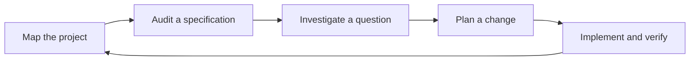

# Project Spec Skills

**Turn a repository into knowledge you can navigate, question, and maintain.**

Four agent skills for understanding existing software, comparing it with its specification, investigating uncertainty, and planning the next change. Start with the code you already have. Keep explanations in English Markdown with links to the evidence.

The knowledge skill produces an **Obsidian-compatible vault**, a JSON Canvas map, and an **offline browser graph**. Obsidian is optional. The other skills work with ordinary repository files, with or without a vault.

## Pick a skill

| Category | Skill | What you get |
| --- | --- | --- |
| Knowledge | [project-knowledge](skills/project-knowledge/SKILL.md) | A linked map of capabilities, behavior, decisions, coverage and gaps; incremental Git review and reconciliation of concurrent vault updates. |
| Quality | [spec-audit](skills/spec-audit/SKILL.md) | A scoped comparison of requirements and implementation, with evidence, priorities and next actions. |
| Investigation | [spec-investigation](skills/spec-investigation/SKILL.md) | An answer to one question, competing explanations, checks actually performed and the smallest useful next check. |
| Planning | [spec-plan](skills/spec-plan/SKILL.md) | A source-grounded implementation plan with dependencies, decision gates and observable acceptance criteria. |

Each skill is independently usable. A useful sequence is:



Implementation is a separate task. Reading a test establishes what it expects; only running it produces a test result.

## Why use this?

- **Onboarding:** follow a workflow across UI, API, policy, persistence and tests without rediscovering the same paths every session.
- **Change planning:** see which rules and related areas a change can affect before writing code.
- **Useful gap reports:** distinguish a missing capability, outdated documentation, an unverified scenario and an undecided product proposal.
- **Team memory:** commit the notes with the project. A manual sync reviews changes from all contributors since the last reviewed commit, including older commits and merges.

The graph records relationships between explanations. It does not infer a complete runtime dependency graph or prove that the deployed application works.

## Install and run

These are [Agent Skills](https://agentskills.io/specification): each folder has a `SKILL.md` entry point. They require an agent that can read your repository. The knowledge helpers need **Python 3.10+** and **Git**; they have no package dependencies. No MCP server, cloud service, paid API or Obsidian plugin is required by the bundle.

### Codex

Ask the built-in skill installer:

```text
Install these skills from WorldStoryCm/project-spec-skills:
skills/project-knowledge
skills/spec-audit
skills/spec-investigation
skills/spec-plan
```

If you already have a skill with the same name, compare versions before replacing it. Installation support and discovery paths depend on the host; the installer in Codex handles its own destination.

Then open your project and ask:

```text
Use $project-knowledge to build an English knowledge vault for this repository.
Trace the main workflows, link claims to source, and record what remains unverified.
```

```text
Use $spec-audit to compare docs/checkout.md with the checkout implementation.
Prioritize real mismatches and list decisions that still need an owner.
```

```text
Use $spec-investigation to explain why a cancelled order still reserves stock.
Read the call path and relevant tests; distinguish evidence from hypotheses.
```

```text
Use $spec-plan to plan a fix for the confirmed reservation issue.
Include affected modules, concurrency checks and acceptance criteria. Plan only.
```

### Any agent with repository access

Clone this repository, then ask the agent to read the chosen `skills/<name>/SKILL.md` and follow it in your target project. Keep that skill's directory intact so its references and scripts resolve. Use your host's documented installation mechanism if it supports skills. Other hosts have not been integration-tested for this release.

## Try the example first

[Parcel Desk](examples/parcel-desk/README.md) is a small, fictional pickup service with a real spec/code disagreement and a ready-made knowledge vault. It includes example audit, investigation and plan outputs.

```sh
git clone https://github.com/WorldStoryCm/project-spec-skills.git
cd project-spec-skills
python3 scripts/verify.py
```

Open `examples/parcel-desk/knowledge/parcel-desk/graph.html` directly in your browser. Search for **cancellation**, select **Gaps**, and follow the evidence links. The HTML contains its data and makes no network requests on load.

To use Obsidian, choose **Open folder as vault** and select `examples/parcel-desk/knowledge/parcel-desk`. Open `00-index`, then **Graph view: Open graph view** from the command palette, or open `Map.canvas` for a card layout. In graph settings, **Existing files only** hides unresolved source links outside the vault. Groups such as `tag:conflict`, `tag:verification-gap` and `tag:product-plan` can distinguish kinds of uncertainty. See [Obsidian's graph guide](https://help.obsidian.md/plugins/graph).

Source links point outside the vault into the repository. Some hosts do not open these paths; the note's `sources` property gives the repository-relative path for your editor. All example application data is invented.

## Keep knowledge current

```text
Use $project-knowledge sync to review all integrated changes since the last
reviewed checkpoint, update affected notes and rebuild the graph.
```

Or narrow the work:

```text
Use $project-knowledge explore permissions to deepen the access-control notes.
Use $project-knowledge gaps to prioritize remaining questions.
Use $project-knowledge check to validate links and source freshness.
```

The agent researches and writes the claims. The Python helpers validate structure, track source fingerprints and render views; running a helper alone does not understand your code. A scan identifies candidate changes. Accepting fingerprints and advancing a Git checkpoint happen only after review. See the [sync workflow](skills/project-knowledge/references/sync.md).

This bundle installs no schedule or hooks and does not commit, push or synchronize other clones automatically. Share the Markdown, reviewed state and chosen skill version through your normal Git workflow. Personal Obsidian settings and local scan reports should stay ignored.

### When two people update the vault

```text
Use $project-knowledge merge to reconcile our knowledge updates from main
and teammate/knowledge. Preserve both contributors' useful notes and stable IDs,
check overlapping claims against source, and report unresolved conflicts.
```

The agent compares the common base and both versions, combines supported changes, and retains unresolved claims with their provenance. A read-only inspector finds changed paths, overlaps and ID collisions. Reviewed fingerprints and Git checkpoints need explicit reconciliation; they are never made current by picking the newest JSON. Derived graphs are rebuilt from the resolved notes. See the [merge workflow](skills/project-knowledge/references/merge.md).

Use separate branches/worktrees or one writer per note for concurrent work. The local finish lock protects bookkeeping, not simultaneous editing across computers. Merge is an agent workflow, not an automatic Git merge driver or a guarantee that contradictory prose can be resolved without a product decision.

## What the files mean

```text
knowledge/<project>/
  00-index.md          start here
  areas/               maps of related capabilities
  notes/               source-backed behaviors and rules
  gaps/                questions, conflicts and proposed changes
  runs/                review history and evidence limits
  Map.canvas           generated Obsidian card map
  graph.html           generated offline browser view
  .knowledge/          fingerprints, view data and reviewed Git checkpoint
```

A red node is a reason to investigate. It can mean missing evidence or an open decision. The [format contract](skills/project-knowledge/references/format.md) explains the statuses and evidence model. Helpers support this format; they are not a general Obsidian vault importer.

## Contributing and verification

See [CONTRIBUTING.md](CONTRIBUTING.md) for the checks, skill boundaries and expectations for examples. [VALIDATION.md](VALIDATION.md) records the actual release checks and limitations. Small, evidence-backed improvements are welcome, especially reproducible cases where a skill confuses intended behavior, implemented behavior and runtime evidence.

The shipped skills and examples are original work, licensed under [MIT](LICENSE). This is an independent project; Obsidian and the agent hosts are not its sponsors. No third-party skill collection is bundled.
