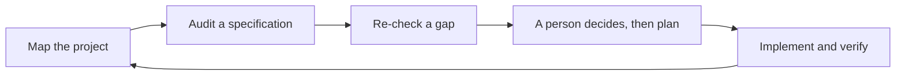

# Project Spec Skills

**Turn a repository into knowledge you can navigate, question, and maintain.**

Four agent skills for understanding existing software, comparing it with its specification, investigating uncertainty, and planning the next change. Start with the code you already have. Keep explanations in English Markdown with links to the evidence.

The knowledge skill produces an **Obsidian-compatible vault** with two clearly separated layers:

- an **as-built spec**: exactly how the code is implemented now, derived only from source. What people or agents agreed in chats is not part of it.
- a **gap queue**: the agent's guesses about what is missing, doubtful or worth adding, one question per page. People re-check each gap and decide it, with a separate discussion and decision for every item.

It also writes an **offline browser map** that groups pages by area. Obsidian is optional. The other skills work with ordinary repository files, with or without a vault.

## Pick a skill

| Category | Skill | What you get |
| --- | --- | --- |
| Knowledge | [project-knowledge](skills/project-knowledge/SKILL.md) | An as-built spec of capabilities and behavior, a separate queue of individually tracked gaps, coverage notes; incremental Git review and reconciliation of concurrent vault updates. |
| Quality | [spec-audit](skills/spec-audit/SKILL.md) | A scoped comparison of requirements and implementation, with evidence, priorities and next actions; in a vault, one gap page per finding. |
| Investigation | [spec-investigation](skills/spec-investigation/SKILL.md) | An answer to one question, competing explanations, checks actually performed and the smallest useful next check; the way to re-check a single gap. |
| Development (experimental) | [spec-change](skills/spec-change/SKILL.md) | Development driven by the spec: you edit the spec on a branch, the agent reviews the diff and asks its questions before any code, then implements it and checks each changed statement against the code. |
| Planning | [spec-plan](skills/spec-plan/SKILL.md) | A source-grounded implementation plan with dependencies, decision gates and observable acceptance criteria; in a vault, only for a gap a person accepted. |

Each skill is independently usable. A useful sequence is:



Implementation is a separate task, except in `spec-change`, which starts from your edits to the spec instead of from a gap. Reading a test establishes what it expects; only running it produces a test result.

## Why use this?

- **Onboarding:** follow a workflow across UI, API, policy, persistence and tests without rediscovering the same paths every session.
- **Change planning:** see which rules and related areas a change can affect before writing code.
- **Useful gap reports:** each doubt is its own page, typed as a missing capability, outdated documentation, an unverified scenario, a conflict or an undecided product proposal, and carries who re-checked it and who decided it.
- **Team memory:** commit the notes with the project. A manual sync reviews changes from all contributors since the last reviewed commit, including older commits and merges.

The graph records relationships between explanations. It does not infer a complete runtime dependency graph or prove that the deployed application works. The agent never records a decision nobody made: accepting, rejecting or deferring a gap is a person's act.

## Install and run

These are [Agent Skills](https://agentskills.io/specification): each folder has a `SKILL.md` entry point. They require an agent that can read your repository. The knowledge helpers need **Python 3.10+** and **Git**; they have no package dependencies. No MCP server, cloud service, paid API or Obsidian plugin is required by the bundle.

### Codex

Ask the built-in skill installer:

```text
Install these skills from WorldStoryCm/project-spec-skills:
skills/project-knowledge
skills/spec-audit
skills/spec-change
skills/spec-investigation
skills/spec-plan
```

If you already have a skill with the same name, compare versions before replacing it. The installer in Codex handles its own destination. In Codex you can name a skill with `$name`, for example `$spec-audit`.

### Claude Code

Copy the whole skill folder (it contains the references and helper scripts) to one of:

- `~/.claude/skills/<name>/` to use it in all your projects, or
- `.claude/skills/<name>/` inside one project.

```sh
git clone https://github.com/WorldStoryCm/project-spec-skills.git
mkdir -p ~/.claude/skills
cp -R project-spec-skills/skills/project-knowledge ~/.claude/skills/
# repeat for spec-audit, spec-change, spec-investigation and spec-plan
```

Then ask in plain language, or invoke a skill by name with `/<name>`, for example `/spec-audit`. Claude Code finds a skill from its description, so an ordinary request often picks the right one.

### Example prompts

These work in any host; use `$name` or `/name` where your host supports it, or just say which skill you mean.

```text
Use the project-knowledge skill to build an English knowledge vault for this repository.
Describe only what the code does, link claims to source, and write every doubt
as its own gap.
```

```text
Use the spec-audit skill to compare docs/checkout.md with the checkout implementation.
Prioritize real mismatches; record each as a separate open gap.
```

```text
Use the spec-investigation skill to re-check the gap "cancelled order still reserves stock".
Read the call path and relevant tests, write the result into the gap's Recheck
section, and leave the decision to me.
```

```text
Use the spec-plan skill to plan the accepted gap "reservation-release".
Include affected modules, concurrency checks and acceptance criteria. Plan only.
```

```text
Use the spec-change skill. I edited the spec on this branch; the diff against main
is the change request. Ask your questions first, then implement it and show me
which statement is covered by which check.
```

### Any agent with repository access

Clone this repository, then ask the agent to read the chosen `skills/<name>/SKILL.md` and follow it in your target project. Keep that skill's directory intact so its references and scripts resolve. Use your host's documented installation mechanism if it supports skills. Hosts other than Codex and Claude Code have not been integration-tested, and the format change described in [VALIDATION.md](VALIDATION.md) has not yet been tested with an agent on any host.

## Try the example first

[Parcel Desk](examples/parcel-desk/README.md) is a small, fictional pickup service with a real spec/code disagreement and a ready-made knowledge vault. The vault shows three gaps at different points of the lifecycle (needs recheck, needs decision, accepted with a plan). It includes example audit, investigation and plan outputs.

```sh
git clone https://github.com/WorldStoryCm/project-spec-skills.git
cd project-spec-skills
python3 scripts/verify.py
```

Open `examples/parcel-desk/knowledge/parcel-desk/graph.html` directly in your browser. It opens in **Read**, the spec as a plain document: areas, the features in each with a one-line summary, and on each page the code detail, open questions and properties folded away. **Map** shows how the pages connect (an open note lists "Gaps about this") and **Gaps** shows the queue (filtered by state, kind and area, with who rechecked and decided and when, and a "recheck outdated" badge when the cited sources changed; each gap links to its spec notes and plan). Search for **cancellation**, open a gap, and follow its links. After `python3 skills/project-knowledge/scripts/knowledge.py build ...` (see the example's README), `AS-BUILT.md` and `GAPS.md` sit beside the graph. The HTML contains its data and makes no network requests on load.

To use Obsidian, choose **Open folder as vault** and select `examples/parcel-desk/knowledge/parcel-desk`. Open `00-index`, then **Graph view: Open graph view** from the command palette (Cmd/Ctrl+G). In graph settings, **Existing files only** hides unresolved source links outside the vault. Pages cluster around their area because each page links to it; run pages carry no links, so they do not pull the clusters together. To see the spec alone, put `-path:gaps -path:plans -path:runs` in the graph's search filter, and add a color group per folder (`path:areas`, `path:notes`, `path:gaps`) under **Groups**. **Open local graph** shows only the neighbours of the page you are reading. Gap properties are searchable, for example `[decision:open]` or `[kind:verification-gap]`. See [Obsidian's graph guide](https://help.obsidian.md/plugins/graph).

Source links point outside the vault into the repository. Some hosts do not open these paths; the note's `sources` property gives the repository-relative path for your editor. All example application data is invented.

## Keep knowledge current

```text
Use the project-knowledge skill to sync: review all integrated changes since the last
reviewed checkpoint, update the affected spec notes, and revisit gaps whose
sources changed. Then rebuild the graph.
```

Or narrow the work:

```text
Ask project-knowledge to explore permissions and deepen the access-control notes.
Ask project-knowledge to work the gaps: re-verify open ones against the current code
and list which are waiting for my decision.
Ask project-knowledge to check links and source freshness.
```

The agent researches and writes the claims. The Python helpers validate structure, track source fingerprints and render views; running a helper alone does not understand your code. A scan identifies candidate changes, and fingerprints are accepted and the Git checkpoint advanced only after review. See the [sync workflow](skills/project-knowledge/references/sync.md). If part of the range cannot be accepted yet, for example because another contributor has uncommitted edits to a file, mark it `deferred`: the rest is accepted, the checkpoint stays where it is and the helper exits with status 3 (not 0, and not 2, which is a usage error).

If `check` fails on a vault written before the spec/gap split, follow the [migration guide](skills/project-knowledge/references/migrate.md).

Everything is manual and nothing is published: the bundle installs no schedule or hooks, and does not commit, push or synchronize other clones. Share the Markdown, reviewed state and chosen skill version through your normal Git workflow. Personal Obsidian settings and local scan reports should stay ignored.

### Gaps are decided by people

A gap starts open. Anyone can re-check it (`spec-investigation` is built for that) and the result is written into the gap with who did it and when. Then a person accepts, rejects or defers it, or the agent finds the code already closes it and marks it done. Only an accepted gap gets a plan. Each gap page has its own `Discussion` and `Decision` sections, and `GAPS.md` lists the queue by state. A recheck means the same thing for every kind of gap, proposals included: it asks only whether the page's description of current behavior still holds in the code ("confirmed (still holds)" or "not reproduced (no longer holds)"), never whether the proposal is a good idea. Details are in [gaps.md](skills/project-knowledge/references/gaps.md).

### When two people update the vault

```text
Use the project-knowledge skill to merge our knowledge updates from main
and teammate/knowledge. Preserve both contributors' useful pages and stable IDs,
check overlapping claims against source, and report unresolved conflicts.
```

The agent compares the common base and both versions, combines supported changes, and retains unresolved claims with their provenance. If two people recorded different decisions on the same gap, it reopens that gap, keeps both positions in its discussion and reports it. A read-only inspector finds changed paths, overlaps and ID collisions. Reviewed fingerprints and Git checkpoints need explicit reconciliation; they are never made current by picking the newest JSON. Derived views are rebuilt from the resolved pages. See the [merge workflow](skills/project-knowledge/references/merge.md).

Use separate branches or worktrees, or one writer per page, for concurrent work. The local finish lock protects bookkeeping, not simultaneous editing across computers. Merge is an agent workflow, not an automatic Git merge driver.

## What the files mean

```text
knowledge/<project>/
  00-index.md           start here
  01-coverage.md        depth reached per area and next actions
  AS-BUILT.md           generated: the as-built specification in one document
  GAPS.md               generated: the gap queue by state
  areas/                maps of related capabilities (spec)
  notes/                source-backed behaviors and rules (spec)
  gaps/                 one question per page (gap)
  plans/                one plan per accepted gap (gap)
  runs/                 review history and evidence limits
  graph.html            generated offline browser view
  .knowledge/           sources.json (reviewed fingerprints), review.json (reviewed Git checkpoint), graph.json (generated view data)
```

Spec pages never link to gaps; a gap links to the spec notes it is about. A gap that needs attention is a reason to look, not a defect list: it can mean unverified behavior, an unmet requirement or an undecided proposal. The [format contract](skills/project-knowledge/references/format.md) explains the page types, properties and evidence model. Helpers support this format; they are not a general Obsidian vault importer.

## Contributing and verification

See [CONTRIBUTING.md](CONTRIBUTING.md) for the checks, skill boundaries and expectations for examples. [VALIDATION.md](VALIDATION.md) records the actual release checks and limitations. Small, evidence-backed improvements are welcome, especially reproducible cases where a skill confuses intended behavior, implemented behavior and runtime evidence.

The shipped skills and examples are original work, licensed under [MIT](LICENSE). This is an independent project; Obsidian and the agent hosts are not its sponsors. No third-party skill collection is bundled.
