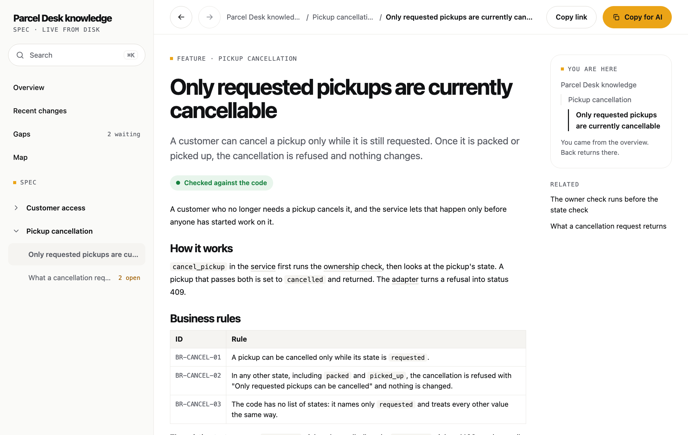

# What the spec contains



## A feature page

Every feature, screen or flow has one page, and all of them have the same sections in the same order. A section the feature does not have is left out.

| Section | What it holds |
| --- | --- |
| Opening | What the feature is for, who uses it and where it is found. |
| `How it works` | What happens, step by step, in the product's words. |
| `Fields` | One row per input: whether it is required, its rule, the message when it is refused. |
| `Business rules` | One numbered row per rule, with the values from the code. |

This is a page from the [Parcel Desk](../examples/parcel-desk/README.md) example, as the agent wrote it:

```markdown
# Only requested pickups are currently cancellable

A customer who no longer needs a pickup cancels it, and the service lets that
happen only before anyone has started work on it.

## How it works

`cancel_pickup` in the service first runs the ownership check, then looks at the
pickup's state. A pickup that passes both is set to `cancelled` and returned.

## Business rules

| ID | Rule |
| --- | --- |
| BR-CANCEL-01 | A pickup can be cancelled only while its state is `requested`. |
| BR-CANCEL-02 | In any other state the cancellation is refused with "Only requested pickups can be cancelled" and nothing is changed. |
```

A rule's number is its name. It stays the same when the rule's text changes, a new rule gets the next free number, and a removed rule's number is never used again, so a number quoted in a ticket, a test or a chat keeps pointing at one rule. `check` fails when a number appears twice in the vault.

Things the code registers in one place and no single feature owns (background jobs, emails, routes, roles, plan limits) are listed in reference pages: one table with every item. A page cites the one to five files that decide its behavior. When one of them changes, the page is marked "Code changed since the last check" until someone re-reads it.

## Big features and several apps

A feature that is too big for one page (more than about twenty rules, or several kinds of use, such as direct, group and support chats) has **parts**. The vault then has three levels: the area, the feature, and its parts. The feature's page says what it is for and lists its parts; each part is a page of the same shape with its own rules. The viewer shows the parts under their feature.

When the product has several clients, such as a web app and a mobile app, a feature page has one more section, `## Where the apps differ`: a table with what each client does, one row per difference.

## How deep the first map goes

The first map starts with an inventory: every page or screen, every server procedure, every job and email, counted from the place that registers them. The agent then takes one feature at a time and finishes it before starting the next. A page whose feature was not read to the end is marked **Partial** and says what is left. A first map of a large project is therefore a number of finished features and a list of the ones not started, not a thin page about everything.

One command shows what is still missing, by reading the code and the pages:

```sh
project-spec coverage                          # every folder, the least covered first
project-spec coverage --path src/features/chat # one feature: each message and limit no page mentions
```

Without the package: `python3 <skill>/scripts/coverage.py --repo .`. For each folder it prints how many files a page cites, and how many messages a person can see and how many named limits are on no page. It is a list of places to read, not a score: some of what it lists is left out of the spec on purpose.

## What the files mean

```text
knowledge/<project>/
  00-index.md           start here
  areas/                maps of related capabilities (spec)
  notes/                one page per feature, plus reference lists (spec)
  gaps/                 one question per page (gap)
  plans/                one plan per accepted gap (gap)
  runs/                 review history and evidence limits
  .knowledge/           sources.json (reviewed fingerprints), review.json (reviewed Git checkpoint)
```

Spec pages never link to gaps; a gap links to the spec notes it is about. A gap that needs attention is a reason to look, not a defect list: it can mean unverified behavior, an unmet requirement or an undecided proposal. The [format contract](../skills/project-knowledge/references/format.md) explains the page types, properties and evidence model. Helpers support this format; they are not a general Obsidian vault importer.
