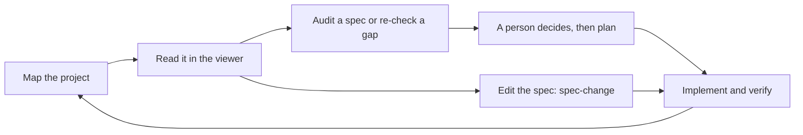

# Working with the skills

Each skill is independently usable. A useful sequence is:



`project-knowledge` never changes application code; `spec-change` is the one that does, and only after it has asked its questions. Reading a test establishes what it expects; only running it produces a test result.

## What it is good for

- **Onboarding:** follow a workflow across UI, API, policy, persistence and tests without rediscovering the same paths every session.
- **Change planning:** see which rules and related areas a change can affect before writing code.
- **Rules you can point at:** a reviewer, a tester or a support person can say "BR-CANCEL-02 is wrong" instead of describing a screen.
- **Useful gap reports:** each doubt is its own page, typed as a missing capability, outdated documentation, an unverified scenario, a conflict or an undecided product proposal, and carries who re-checked it and who decided it.
- **Team memory:** commit the notes with the project. A manual sync reviews changes from all contributors since the last reviewed commit, including older commits and merges.

The graph records relationships between explanations. It does not infer a complete runtime dependency graph or prove that the deployed application works. The agent never records a decision nobody made: accepting, rejecting or deferring a gap is a person's act.

## Example prompts

These work in any host; use `$name` or `/name` where your host supports it, or just say which skill you mean.

```text
Use the project-knowledge skill to build an English knowledge vault for this repository.
Describe only what the code does: one page per feature with its business rules,
each claim linked to source, and every doubt as its own gap.
```

```text
Use the project-knowledge skill to audit docs/checkout.md against the checkout implementation.
Prioritize real mismatches; record each as a separate open gap.
```

```text
Use the project-knowledge skill to re-check the gap "cancelled order still reserves stock".
Read the call path and relevant tests, write the result into the gap's Recheck
section, and leave the decision to me.
```

```text
Use the spec-change skill to plan the accepted gap "reservation-release".
Include affected modules, concurrency checks and acceptance criteria. Plan only.
```

```text
Use the spec-change skill. I edited the spec on this branch; the diff against main
is the change request. Ask your questions first, then implement it and show me
which statement is covered by which check.
```

## Try the example first

[Parcel Desk](../examples/parcel-desk/README.md) is a small, fictional pickup service with a real spec/code disagreement and a ready-made knowledge vault. The vault shows three gaps at different points of the lifecycle (needs recheck, needs decision, accepted with a plan). It includes example audit, investigation and plan outputs.

```sh
git clone https://github.com/WorldStoryCm/project-spec-skills.git
cd project-spec-skills
python3 scripts/verify.py
```

Start the viewer on the example:

```sh
python3 skills/project-knowledge/scripts/knowledge.py serve --repo examples/parcel-desk --open
```

Search for **cancellation**, open a gap, follow its links and try "Copy for AI" on it. [The viewer](viewer.md) describes every screen.

To use Obsidian, choose **Open folder as vault** and select `examples/parcel-desk/knowledge/parcel-desk`. Open `00-index`, then **Graph view: Open graph view** from the command palette (Cmd/Ctrl+G). In graph settings, **Existing files only** hides unresolved source links outside the vault. Pages cluster around their area because each page links to it; run pages carry no links, so they do not pull the clusters together. To see the spec alone, put `-path:gaps -path:plans -path:runs` in the graph's search filter, and add a color group per folder (`path:areas`, `path:notes`, `path:gaps`) under **Groups**. **Open local graph** shows only the neighbours of the page you are reading. Gap properties are searchable, for example `[decision:open]` or `[kind:verification-gap]`. See [Obsidian's graph guide](https://help.obsidian.md/plugins/graph).

Source links point outside the vault into the repository. Some hosts do not open these paths; the note's `sources` property gives the repository-relative path for your editor. All example application data is invented.

## Keep knowledge current

```text
Use the project-knowledge skill to sync: review all integrated changes since the last
reviewed checkpoint, update the affected spec notes, and revisit gaps whose
sources changed.
```

Or narrow the work:

```text
Ask project-knowledge to explore permissions and deepen the access-control notes.
Ask project-knowledge to work the gaps: re-verify open ones against the current code
and list which are waiting for my decision.
Ask project-knowledge to check links and source freshness.
```

The agent researches and writes the claims. The Python helpers validate structure, track source fingerprints and render views; running a helper alone does not understand your code. A scan identifies candidate changes, and fingerprints are accepted and the Git checkpoint advanced only after review. See the [sync workflow](../skills/project-knowledge/references/sync.md). If part of the range cannot be accepted yet, for example because another contributor has uncommitted edits to a file, mark it `deferred`: the rest is accepted, the checkpoint stays where it is and the helper exits with status 3 (not 0, and not 2, which is a usage error).

If `check` fails on a vault written before the spec/gap split, follow the [migration guide](../skills/project-knowledge/references/migrate.md). The same guide has the regroup pass for a vault whose feature pages lack the sections above, or whose rules were spread over separate table pages per kind.

Everything is manual and nothing is published: the bundle installs no schedule or hooks, and does not commit, push or synchronize other clones. Share the Markdown, reviewed state and chosen skill version through your normal Git workflow. Personal Obsidian settings and local scan reports should stay ignored.

## Gaps are decided by people

A gap starts open. Anyone can re-check it (ask `project-knowledge` to recheck it) and the result is written into the gap with who did it and when. Then a person accepts, rejects or defers it, or the agent finds the code already closes it and marks it done. Only an accepted gap gets a plan. Each gap page has its own `Discussion` and `Decision` sections, and the viewer lists the queue by state. A recheck means the same thing for every kind of gap, proposals included: it asks only whether the page's description of current behavior still holds in the code ("confirmed (still holds)" or "not reproduced (no longer holds)"), never whether the proposal is a good idea. Details are in [gaps.md](../skills/project-knowledge/references/gaps.md).

## When two people update the vault

```text
Use the project-knowledge skill to merge our knowledge updates from main
and teammate/knowledge. Preserve both contributors' useful pages and stable IDs,
check overlapping claims against source, and report unresolved conflicts.
```

The agent compares the common base and both versions, combines supported changes, and retains unresolved claims with their provenance. If two people recorded different decisions on the same gap, it reopens that gap, keeps both positions in its discussion and reports it. A read-only inspector finds changed paths, overlaps and ID collisions. Reviewed fingerprints and Git checkpoints need explicit reconciliation; they are never made current by picking the newest JSON. Derived views are rebuilt from the resolved pages. See the [merge workflow](../skills/project-knowledge/references/merge.md).

Use separate branches or worktrees, or one writer per page, for concurrent work. The local finish lock protects bookkeeping, not simultaneous editing across computers. Merge is an agent workflow, not an automatic Git merge driver.
