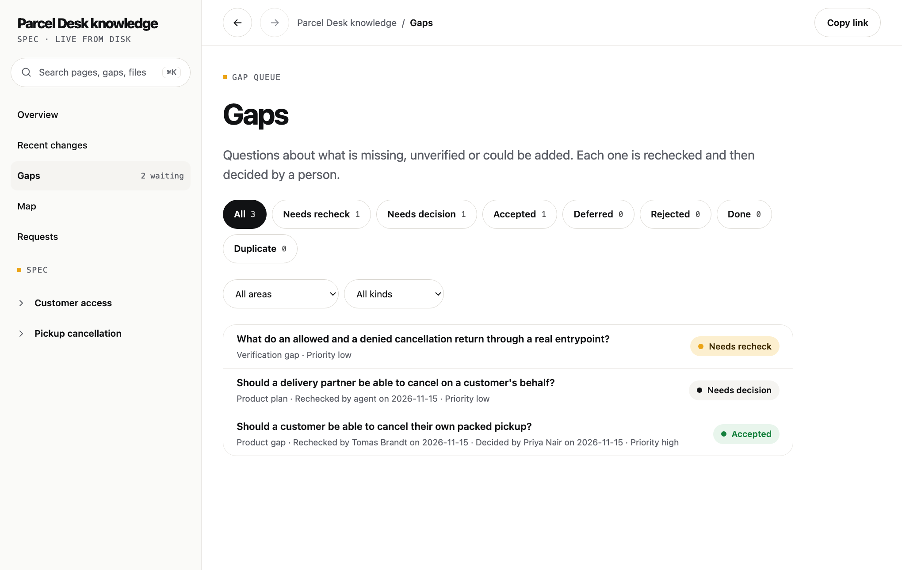

# Parcel Desk: a fictional worked example

The spec, Python source, tests and customer IDs are invented for this repository. The source deliberately disagrees with one accepted requirement, so an audit has something concrete to find.

Read it with the viewer (from the repository root: `python3 skills/project-knowledge/scripts/knowledge.py serve --repo examples/parcel-desk --open`) or open `knowledge/parcel-desk` as an Obsidian vault. The Markdown claims cite the files alongside this README, and the viewer opens those files in place.



The vault shows the two layers the skills produce. The **as-built spec** (`areas/`, `notes/`, generated `AS-BUILT.md`) describes only what the code does. The **gap queue** (`gaps/`, `plans/`, generated `GAPS.md`) holds three questions, one per page, at different points of the lifecycle:

| Gap | State | What it shows |
| --- | --- | --- |
| [deployment-evidence](knowledge/parcel-desk/gaps/deployment-evidence.md) | `needs-recheck` | Raised by an agent, not yet re-verified by anyone. |
| [partner-decision](knowledge/parcel-desk/gaps/partner-decision.md) | `needs-decision` | Rechecked, now waiting for a person to decide; the options sit in `Discussion`. |
| [packed-cancellation](knowledge/parcel-desk/gaps/packed-cancellation.md) | `accepted` | Rechecked and accepted by a (fictional) person, with [a plan](knowledge/parcel-desk/plans/packed-cancellation.md). |

`AS-BUILT.md` and `GAPS.md` are written by `build`; they are not in a fresh checkout of the Markdown until you run it.

## Follow the example

1. Read [the requirements](SPEC.md) and inspect [the route](src/routes.py) and [the service](src/pickups.py).
2. Browse [the knowledge index](knowledge/parcel-desk/00-index.md).
3. Compare the example [audit](reports/audit.md), [investigation](reports/investigation.md) and [plan](reports/plan.md), each in the report shape its skill defines.

These reports are worked examples, not transcripts of an independent agent evaluation. They distinguish reading tests from running them. In a vault the audit's findings become the gap pages, the investigation's result goes into a gap's `Recheck` section, and the plan becomes a `plans/` page for an accepted gap. The release checks and fresh-agent evaluations are documented separately in the repository's validation record.

Run the fixture tests from this folder:

```sh
python3 -m unittest discover -s tests -v
```

They omit a packed-pickup test. A green suite therefore does not establish compliance with CAN-1.

## Rebuild the example graph

From the repository root:

```sh
python3 skills/project-knowledge/scripts/knowledge.py check \
  --repo examples/parcel-desk --vault examples/parcel-desk/knowledge/parcel-desk --strict
python3 skills/project-knowledge/scripts/knowledge.py build \
  --repo examples/parcel-desk --vault examples/parcel-desk/knowledge/parcel-desk
```

The included source hashes describe the shipped fixture. Changing a source produces a freshness warning; rebuilding alone does not accept it. After actually reviewing the new source and updating a note, accept only the affected note's fingerprints with `snapshot --notes <id>`.

This example has no baked-in Git review cursor. The enclosing toolkit is a different repository from the fictional application. To experiment with `sync`, copy this example to a disposable directory, initialize its own Git repository and let the skill research and initialize a real checkpoint. The [evaluation scenarios](../../docs/evaluation.md) describe this exercise.
